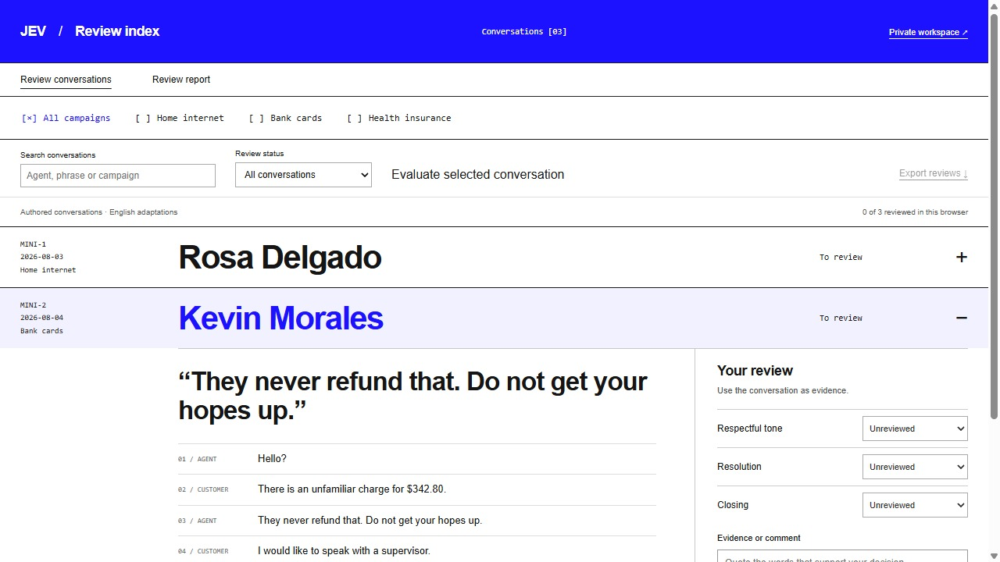
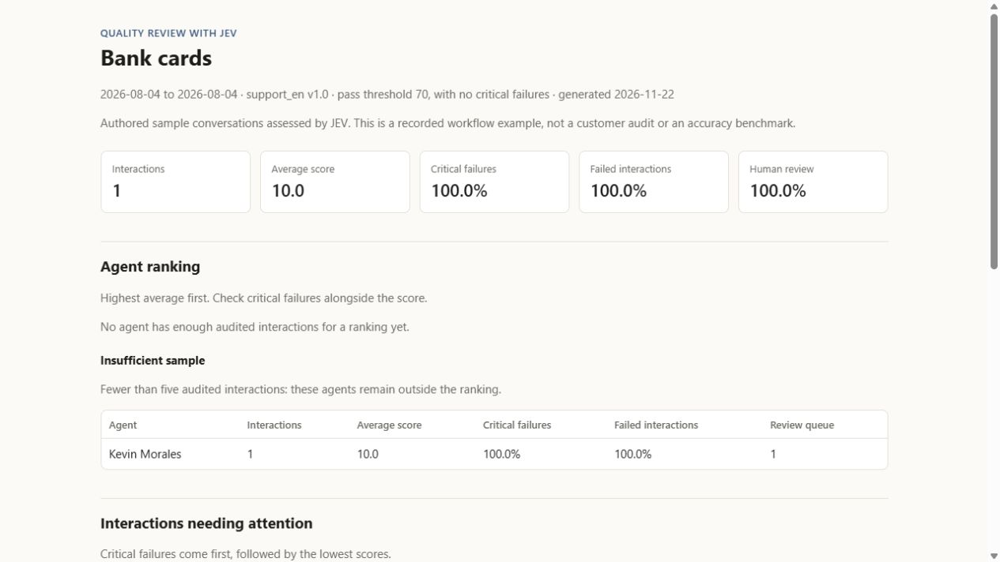

# JEV Contact Center QA

Evaluate support-call transcripts against a fixed quality rubric, route uncertain cases to human review, and produce campaign reports.

This Python CLI combines transcript redaction, a structured Jev model request, deterministic scoring, and comparison against human labels. It uses the Python standard library and includes an offline fake client.

[Guía completa en español](README.es.md)

## Try the review workspace

[Open the English review workspace](https://kennethyepez.com/work/jev-contact-center-qa/review/) · [Product overview](https://kennethyepez.com/projects/jev-contact-center-qa) · [Reproduce the engine workflow](docs/NATIVE-DEMO.md)



Search and filter three authored conversations, save manual reviews and unfinished drafts in your browser, and export your decisions. **View recorded assessment** opens the real eight-criterion JEV result for the selected conversation, including critical failures, uncertainty and its full campaign report. It reads saved results; it does not make a new model request. No provider credential or private inference endpoint is exposed.

The public example keeps manual reviewer decisions separate from model judgments. For fresh evaluations and passkey-protected workspace copies, use the [private/local setup](demo/README.md).

The original Python application audited three existing authored conversations with the live JEV model, generated one report per campaign and resumed without repeating completed requests. English reports retain its original layout, weighted scoring, critical-failure rules and uncertainty queue. These examples demonstrate the connected workflow; they do not establish model accuracy or customer outcomes.

## Original engine

The review workspace presents the original Python engine's recorded results alongside its native campaign reports.



[Run locally](demo/README.md) · [Desktop and phone views](docs/PRODUCT.md)

The three manual ratings are not the engine's eight-item rubric. Live evaluations and private workspace access retain their existing setup and passkey flow; the public example does not simulate either.

## Project direction and use

[Kenneth Yepez](https://github.com/kennethyepez) directs product requirements, architecture, integration, validation, and deployment. AI coding agents implement code under his direction.

See [use and licensing](LICENSE.md), [contributing](CONTRIBUTING.md), and [security reporting](SECURITY.md).

## Architecture

```text
Transcript CSV
  -> redact supported identifiers and supplied names
  -> one Jev request per interaction
  -> weighted score, critical failures, and review queue
  -> resumable results CSV
  -> campaign HTML report / comparison with human labels
```

| Module | Responsibility |
| --- | --- |
| [anonymize.py](jevqa/anonymize.py) | Identifier detection and redaction before model calls |
| [rubric.py](jevqa/rubric.py) | Request construction and rubric response parsing |
| [pipeline.py](jevqa/pipeline.py) | Concurrent, rate-limited batches and resumption |
| [scoring.py](jevqa/scoring.py) | Weighted score, pass/fail, and review routing |
| [report.py](jevqa/report.py) | Campaign HTML reports |
| [compare.py](jevqa/compare.py) | Agreement, kappa, and confusion matrices |

The [Spanish support rubric](rubrics/soporte_es.json) contains eight weighted items totaling 100 points. Three are critical. A passing score requires at least 70 points and no failed critical item; confidence and ambiguity thresholds control the review queue.

## Offline quickstart

Requires Python 3.12 or newer. From the repository root:

```bash
python -m jevqa auditar tests/fixtures/mini.csv --salida salidas/mini_resultados.csv --fake
python -m jevqa informe salidas/mini_resultados.csv --salida salidas --fake
python -m unittest discover -s tests
```

The CSV and HTML reports appear under the ignored `salidas/` directory. Fake scores exercise the workflow and report format; they are not model-quality measurements.

To exercise evaluation without network calls:

```bash
python scripts/eval_jev.py --fake --salida salidas/informe_eval_fake.md
```

The CLI keeps its Spanish command and column names. Input CSV columns are `id`, `agente`, `campaña` (or `campana`), `fecha`, and `texto`; `cliente` is optional. See [the example](tests/fixtures/mini.csv).

For a real model run, supply your own `TYPESAFE_API_KEY` through the environment and omit `--fake`. Real auditing sends redacted transcripts to the provider and incurs API usage. Reporting and comparison operate on local files.

## Recorded evaluation

**Evaluation status: experimental.** The published Spanish results do not establish reliable autonomous scoring. The translated English demo needs its own evaluation. See [the independent evaluation plan](docs/EVALUATION-PLAN.md).

The [September 21, 2026 report](data/eval/informe.md) records a live model run on **40 authored synthetic conversations**, labeled by one annotator.

| Measure | Recorded result |
| --- | --- |
| Agreement across the eight rubric items | 90–100% per item |
| Identity-verification failure recall | 1 of 4 failures detected (25%) |
| Diagnosis failure recall | 0 of 2 failures detected (0%) |
| High-confidence realistic-commitment judgments | 12 of 40 interactions |

High agreement on mostly passing examples can hide poor failure detection. The failure-recall results are central to interpreting this evaluation. These measurements describe the committed run, not a new benchmark or a customer pilot.

## Tradeoffs and limits

- Redaction covers supported identifiers and names supplied in the CSV. Unlisted third-party names can remain in the text.
- Synthetic transcripts omit much of the noise found in real speech transcription; the dataset is small and has no second annotator.
- Thresholds trade missed failures against human-review workload. Calibration needs a separate evaluation set.
- Batch resumption skips IDs already present in the output. Use a fresh output path when intentionally reevaluating the same interactions.
- The current rubric targets Spanish support calls. Review the Spanish guide's data-handling and pilot prerequisites before using customer transcripts.

The next evaluation should measure failure recall and reviewer workload on an authorized pilot dataset. See [the project plan](docs/plan.md) and [the complete operating guide](README.es.md).

## Reviewed delivery

See the [delivery workflow](docs/DELIVERY.md) for acceptance criteria, commit boundaries, identified AI/human review, protected integration, and source provenance.

## Measured workflow case

The [complete campaign reporting case](docs/CASE-STUDY.md) records actual repeated local CLI execution, links all three authored-fixture reports, and distinguishes those measurements from model quality or customer outcomes.
