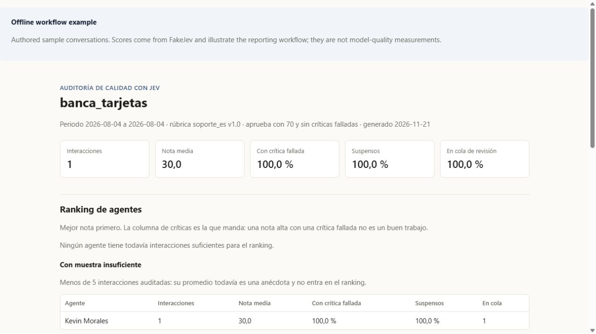

# Contact-center report workflow



## Reproduce

Python 3.12 or 3.13; standard library for this offline path. Live providers require separate configuration.

Use an isolated checkout and environment.

```bash
python -m unittest discover -s tests -v
python tools/create_demo.py
```

Serve the generated files locally:

```bash
python -m http.server 8000 --bind 127.0.0.1 --directory docs/examples
```

Open `http://127.0.0.1:8000/sample-report.html`.

## What the example establishes

The actual audit and report CLI processes the committed mini CSV with --fake. The visible report is the banca_tarjetas campaign with one interaction; the CLI processes three fixture interactions across three campaigns. Scores and displayed costs are illustrative FakeJev output, not measured model results, actual provider charges, or customer interactions. The separately committed evaluation describes its synthetic-data and single-annotator limitations.

The screenshot records the visible output of this workflow. It does not establish behavior outside the stated scope. Generated evidence and source examples are preserved alongside the walkthrough; current CI runs provide commit-specific checks.
