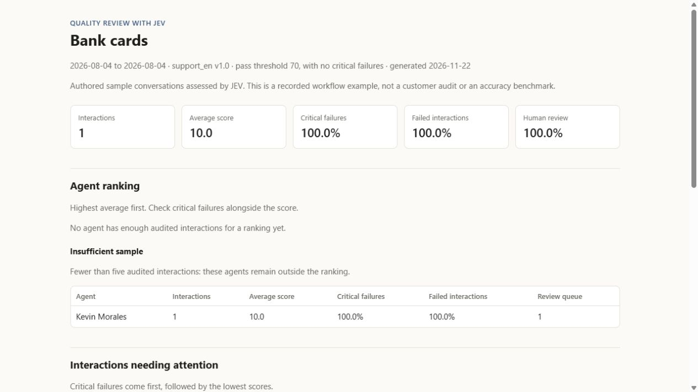
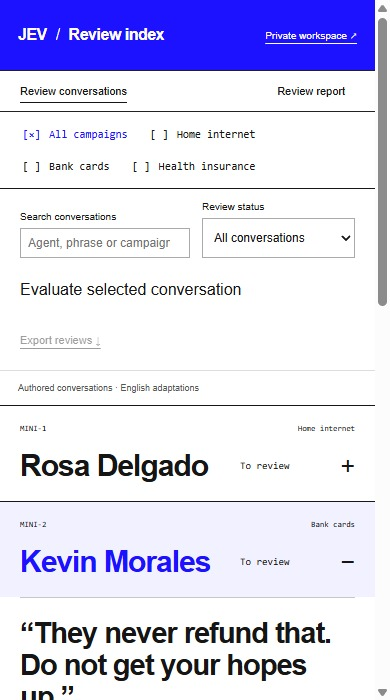

# JEV Contact Center QA — product review

A conversation review index with evidence notes, resumable drafts and campaign reports.

## Original application reports

[Open the native campaign reports](https://kennethyepez.com/projects/jev-contact-center-qa) · [Run the original CLI](NATIVE-DEMO.md)

The original Python app audited the three authored English conversations with JEV and produced these campaign reports. The native report layout remains intact; the English rubric now selects English report labels. Critical failures override the numeric score, and uncertain judgments remain in the human-review queue. Public reports are recorded outputs, with no provider credential or live inference endpoint exposed.

The conversation-review interface below remains a separate local surface; these screenshots do not turn the original CLI into a hosted web application.

## Desktop

## Phone

## Try it

Follow [local setup](../demo/README.md). Guest exploration uses authored examples. The [engine setup](../demo/ENGINES.md) explains which actions use the repository engine and which need private provider configuration. Private workspace access uses the existing passkey flow.

These are original browser captures of the current interface. No image was cropped, resized or regenerated. The CSS maintenance change preserves the selected composition and removes the other products’ styles.
