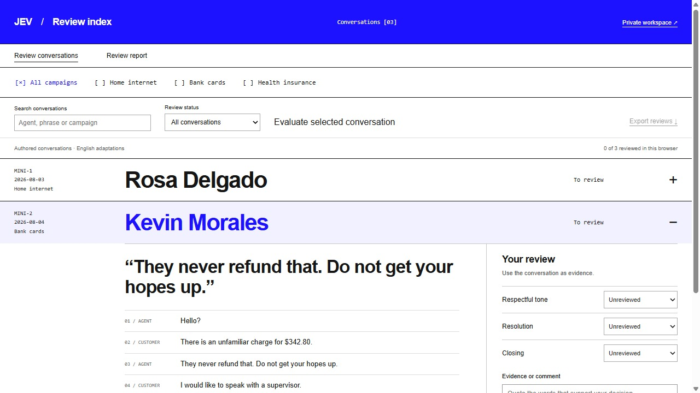
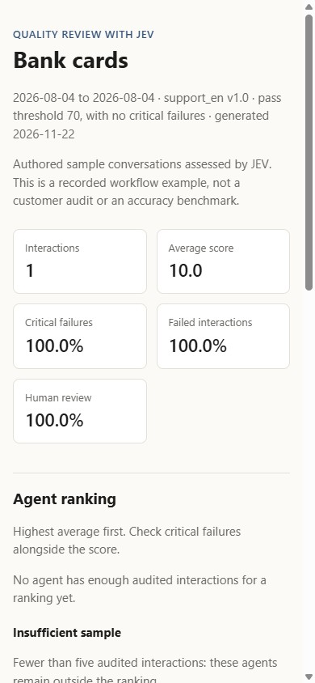

# JEV Contact Center QA — product review

A conversation review index with evidence notes, resumable drafts and campaign reports.

## Review workspace

[Open the English Review Index](https://kennethyepez.com/work/jev-contact-center-qa/review/). The original blue interface is the main public demo: search, filter, read transcripts, resume drafts, save manual reviews and export CSV. **View recorded assessment** displays the selected conversation's actual eight-criterion JEV result. The three authored examples use saved model output; the public workspace does not perform fresh inference. The separate local workspace retains live evaluation and passkey access.

## Original application reports

[Open the native campaign reports](https://kennethyepez.com/projects/jev-contact-center-qa) · [Run the original CLI](NATIVE-DEMO.md)

The original Python app audited the three authored English conversations with JEV and produced these campaign reports. The native report layout remains intact; the English rubric now selects English report labels. Critical failures override the numeric score, and uncertain judgments remain in the human-review queue. Public reports are recorded outputs, with no provider credential or live inference endpoint exposed.

The native reports support the main Review Index. They retain the Python engine's scoring and layout; the public interface reads the same committed results.

## Desktop

## Phone

## Try it

Use the [public review workspace](https://kennethyepez.com/work/jev-contact-center-qa/review/) or follow [local setup](../demo/README.md). Guest exploration uses authored examples. The [engine setup](../demo/ENGINES.md) explains live evaluations and private provider configuration. Private workspace access uses the existing passkey flow.

These are original browser captures of the current interface. No image was cropped, resized or regenerated. The CSS maintenance change preserves the selected composition and removes the other products’ styles.
